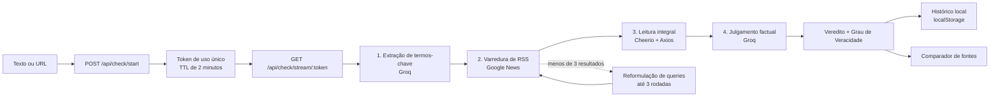

<p align="center">
  <picture>
    <source media="(prefers-color-scheme: dark)" srcset="static/img/Logo_white.png">
    <source media="(prefers-color-scheme: light)" srcset="static/img/Logo.png">
    
  </picture>
</p>


<p align="center">
  <strong>Checagem factual automatizada, rastreável e em tempo real.</strong><br>
  Da alegação ao veredito — com evidências, fontes e grau de veracidade.
</p>

<p align="center">
  <a href="https://nodejs.org/"></a>
  <a href="https://expressjs.com/"></a>
  <a href="https://console.groq.com/"></a>
  <a href="https://developer.mozilla.org/docs/Web/API/Server-sent_events"></a>
  <a href="https://verifica-ai-five.vercel.app/"></a>
  <a href="#roadmap"></a>
  <a href="package.json"></a>
  <a href="LICENSE"></a>
</p>

---

> **VerificaAI** é um desk de investigação e checagem factual que cruza alegações textuais ou URLs com fontes jornalísticas indexadas no Google News. O sistema aplica um pipeline documental em quatro etapas, conduzido por modelos GPT-OSS via Groq, e devolve um diagnóstico estruturado com **Grau de Veracidade (0–100%)**, trechos conflitantes, fontes consultadas e comparação lado a lado da postura editorial de cada veículo.

Em um cenário em que uma alegação falsa circula mais rápido do que sua correção, validar um fato ainda exige abrir dezenas de abas, comparar veículos, identificar enquadramentos e, no fim, conviver com uma impressão subjetiva. O VerificaAI transforma esse processo em um **fluxo auditável**: cada veredito é acompanhado das evidências que o sustentam — ou da ausência explícita delas.

O projeto foi concebido como **Trabalho de Conclusão de Curso (TCC)** e combina rigor jornalístico, transparência metodológica e engenharia de software aplicada à integridade informacional.

> **Experimente agora:** o VerificaAI está publicado em **[verifica-ai-five.vercel.app](https://verifica-ai-five.vercel.app/)**. Não é preciso instalar nada — basta abrir o site no navegador e informar sua chave gratuita do Groq para começar a verificar alegações.

## Sumário

- [Acesso online](#acesso-online)
- [Visão geral](#visão-geral)
- [Funcionalidades](#funcionalidades)
- [Pipeline de verificação](#pipeline-de-verificação)
- [Stack tecnológico](#stack-tecnológico)
- [Arquitetura](#arquitetura)
- [Interface e identidade visual](#interface-e-identidade-visual)
- [Segurança e privacidade](#segurança-e-privacidade)
- [Instalação](#instalação)
- [Configuração](#configuração)
- [Como usar](#como-usar)
- [API HTTP e SSE](#api-http-e-sse)
- [Roadmap](#roadmap)
- [Limitações e uso responsável](#limitações-e-uso-responsável)
- [Contribuindo](#contribuindo)
- [Criadores](#criadores)
- [Licença](#licença)
- [Documentação e referências](#documentação-e-referências)

## Acesso online

A forma mais rápida de usar o VerificaAI é pela versão hospedada:

**[https://verifica-ai-five.vercel.app/](https://verifica-ai-five.vercel.app/)**

O site roda o mesmo pipeline de verificação descrito neste documento — extração de termos, varredura no Google News, leitura integral das matérias e julgamento factual — com progresso em tempo real via SSE. Nenhuma instalação é necessária.

| Item | Detalhe |
| :--- | :--- |
| **Chave Groq** | Obrigatória e gratuita. Cadastre em [console.groq.com/keys](https://console.groq.com/keys) e cole no botão **"Chave API"** do site. |
| **Onde a chave fica** | Apenas no `localStorage` do seu navegador; ela não é persistida no servidor. |
| **Histórico** | Também local, no seu navegador, limitado a 50 verificações. |
| **Custo** | O uso do site é gratuito; o consumo é debitado da sua própria cota Groq. |
| **Instalação local** | Opcional. Siga [Instalação](#instalação) caso queira executar o projeto na sua máquina ou contribuir com o código. |

> A versão online é uma instância pública de demonstração. Para uso intensivo, apurações sensíveis ou desenvolvimento, prefira rodar o projeto localmente.

## Visão geral

### O problema

A desinformação não vence por ser convincente; vence por ser **mais rápida** do que o trabalho de checagem. Ferramentas genéricas de IA, por outro lado, tendem a produzir respostas fluidas e opacas — sem fontes verificáveis, sem critérios explícitos e sem distinção entre "não encontrei evidências" e "a alegação é falsa".

### A proposta

O VerificaAI trata a verificação como um **procedimento documental**, não como uma opinião gerada por modelo. A entrada pode ser um texto colado ou a URL de uma matéria. A saída é um dossiê com:

- **Veredito categórico** e **Grau de Veracidade** com limiares públicos;
- **Resumo analítico** adaptável em extensão;
- **Erros encontrados**, partes corretas e recomendação editorial;
- **Fontes jornalísticas** com título, veículo, idioma e link;
- **Comparação de posturas** (`confirma`, `contradiz`, `neutro`) por veículo;
- **Progresso em tempo real** de cada etapa do pipeline via Server-Sent Events.

### Diferenciais

| Princípio | Como aparece no produto |
| :--- | :--- |
| **Rigor documental** | Todo veredito é ancorado em artigos rastreáveis, com URL e veículo de origem. |
| **Transparência metodológica** | Limiares explícitos de veracidade, exibição de contradições e distinção entre falso e não encontrado. |
| **Privacidade por padrão** | Chave Groq e histórico são armazenados no navegador; nada é persistido no servidor. |
| **Feedback em tempo real** | SSE transmite etapas, termos extraídos, queries e leitura de fontes enquanto o pipeline executa. |
| **Sobriedade editorial** | Identidade visual inspirada em jornais de referência e publicações acadêmicas, sem ruído decorativo. |

## Funcionalidades

| Recurso | O que faz | Destaque técnico |
| :--- | :--- | :--- |
| **Extração inteligente de termos** | Identifica idioma, 4–6 palavras-chave e 2 queries de busca a partir da alegação. | Groq com `response_format: json_object`; fallback heurístico por frequência e stopwords se a IA falhar. |
| **Coleta via Google News RSS** | Varre o feed de notícias com parâmetros de idioma e região (`hl`, `gl`, `ceid`). | `rss-parser`; deduplicação por URL; até 3 rodadas de busca. |
| **Reformulação automática de queries** | Se a primeira busca retornar menos de 3 artigos, a IA gera queries mais amplas. | Até duas reformulações sucessivas, preservando o idioma original. |
| **Web scraping seletivo** | Lê o conteúdo integral das matérias para além do snippet do RSS. | `axios` + `cheerio`; remoção de `script/style/nav/footer`; extração de parágrafos com mais de 80 caracteres; limite de 5.000 caracteres por matéria. |
| **Análise comparativa e veredito** | Cruza evidências, classifica a postura de cada fonte e emite um JSON estruturado. | GPT-OSS 120B/20B; modo rigoroso exige ao menos 3 fontes independentes para "VERDADEIRA". |
| **Grau de Veracidade** | Substitui a "confiança" vaga por faixas objetivas e auditáveis. | 0–29% falsa; 30–69% parcial; 70–100% factual; `?`/`N/A` quando não há evidências. |
| **Comparador lado a lado** | Modal em grid com a posição de cada veículo e trechos que sustentam a classificação. | Categorias `confirma`, `contradiz` e `neutro`. |
| **Histórico local** | Lista, detalha, exclui e limpa verificações anteriores. | `localStorage` (`verificai_historico`), máximo de 50 itens, sem envio ao servidor. |
| **Painel avançado** | Controla quantidade de artigos, idioma, tamanho do resumo, modelo e rigor. | Opções validadas e normalizadas no backend com allowlists. |
| **Tema claro/escuro** | Alterna a paleta editorial e persiste a preferência. | `data-theme` + `localStorage` (`verificai_theme`). |
| **Hardening para web** | Protege o servidor contra SSRF, abuso, prompt injection e vazamento de erros. | `helmet`, `express-rate-limit`, validação de DNS no momento da conexão e tokens de uso único. |

## Pipeline de verificação



### As quatro etapas

| Etapa | Processamento | Técnica | Eventos emitidos |
| :---: | :--- | :--- | :--- |
| **1** | Detecção de idioma, extração de palavras-chave e geração de queries. | Groq + JSON estruturado; fallback local se a chamada falhar. | `step`, `keywords` |
| **2** | Busca de artigos no Google News RSS, com deduplicação e reformulação. | `rss-parser`; queries ampliadas quando há menos de 3 resultados. | `query`, `articles_found` |
| **3** | Leitura do conteúdo integral das matérias, respeitando paywalls. | `cheerio` + `axios` via `getUrlSeguro`; limite de 2 MB e timeout de 8–10 s. | `reading` |
| **4** | Cruzamento de evidências e emissão do veredito. | Groq com schema JSON, defesa contra prompt injection e modo rigoroso opcional. | `result` ou `error` |

Se a entrada for uma URL, o conteúdo da página é extraído **antes** da etapa 1. Quando a extração falha ou o veículo está protegido por paywall, o sistema interrompe com uma mensagem explícita, em vez de analisar apenas o título.

### Por que SSE e não WebSocket?

O fluxo é estritamente **unidirecional**: o servidor informa o progresso, o cliente apenas escuta. SSE oferece a solução mais simples e robusta para esse caso:

- `EventSource` é nativo no navegador, sem dependências adicionais;
- reconexão e tratamento de eventos são padronizados;
- funciona sobre HTTP/1.1 e atravessa proxies comuns;
- o servidor envia `X-Accel-Buffering: no` para evitar buffering em nginx;
- o token é de **uso único**, com TTL de 2 minutos, evitando streams órfãos.

### Eventos transmitidos

| Evento | Payload | Uso na interface |
| :--- | :--- | :--- |
| `options` | `{ max_artigos, modelo, idioma_forca, tamanho_resumo, rigoroso }` | Diagnóstico da configuração aplicada. |
| `step` | `{ step, msg }` | Atualiza o indicador "Etapa N de 4". |
| `keywords` | `{ idioma, keywords[] }` | Exibe os termos selecionados pela IA. |
| `query` | `{ query, idioma }` | Mostra a busca em execução. |
| `articles_found` | `{ count }` | Informa quantos artigos foram indexados. |
| `reading` | `{ titulo, fonte, url }` | Exibe o veículo sendo lido. |
| `result` | Objeto completo do veredito | Renderiza o card, o resumo e as fontes. |
| `error` | `{ msg }` | Interrompe a apuração com mensagem controlada. |

### Grau de Veracidade

| Faixa | Classificação | Interpretação |
| :---: | :--- | :--- |
| **0–29%** | Falsa / Invenção | Alegação majoritariamente falsa, inventada ou distorcida; fontes contradizem os fatos centrais. |
| **30–69%** | Parcialmente Verdadeira | Há fundo de verdade, mas com exageros, omissões ou contradições entre fontes. |
| **70–100%** | Factual / Verídica | Fatos centrais confirmados por fontes confiáveis, sem contradição relevante. |
| **`?`** | Não encontrada nos sites | Nenhum artigo sustenta a alegação ou o fato é obscuro demais para ser verificado. A interface exibe `N/A` nesse caso. |

No **Modo Rigoroso**, o veredito "VERDADEIRA" só é emitido quando pelo menos **3 fontes independentes** confirmam os fatos centrais. Com menos de 3, o resultado é rebaixado para "PARCIALMENTE VERDADEIRA".

### Saída estruturada

O modelo responde em JSON validado, com os seguintes campos:

| Campo | Tipo | Descrição |
| :--- | :--- | :--- |
| `veredicto` | string | `VERDADEIRA`, `FALSA`, `PARCIALMENTE VERDADEIRA` ou `NÃO ENCONTRADA NOS SITES`. |
| `grau_veracidade` | number \| null | Pontuação de 0 a 100; `null` quando não há evidências. |
| `resumo` | string | Análise factual no tamanho escolhido (curto, médio ou detalhado). |
| `encontrada_em` | string[] | Veículos que corroboram a alegação. |
| `erros_encontrados` | object[] | Trecho problemático, problema identificado e versão correta. |
| `partes_corretas` | string[] | Afirmações que se confirmaram. |
| `artigos_relacionados` | object[] | Título, fonte, idioma e URL das matérias consultadas. |
| `comparacao_fontes` | object[] | Fonte, posição (`confirma`, `contradiz`, `neutro`) e resumo da postura. |
| `recomendacao` | string | Orientação editorial para o leitor ou jornalista. |

## Stack tecnológico

| Camada | Tecnologia | Papel no projeto |
| :--- | :--- | :--- |
| **Runtime** | Node.js 20.18+ (ESM nativo) | Execução do servidor e do pipeline assíncrono. |
| **Backend** | Express 4 | Rotas de páginas, API de início e stream SSE. |
| **IA** | Groq SDK + `openai/gpt-oss-120b` / `openai/gpt-oss-20b` | Extração de termos, reformulação de queries e julgamento factual. |
| **Coleta** | `rss-parser` + `axios` | Leitura do Google News RSS e download das matérias. |
| **Extração** | `cheerio` | Parsing de HTML, remoção de ruído e extração de parágrafos. |
| **Frontend** | HTML5, CSS3 e Vanilla JavaScript (ES6+) | Interface sem build step, com `fetch`, `EventSource` e manipulação direta do DOM. |
| **Tempo real** | Server-Sent Events | Progresso do pipeline em quatro etapas. |
| **Segurança** | `helmet`, `express-rate-limit`, `url-safety.js` | CSP, limitação de requisições, validação de URLs e defesa contra SSRF. |
| **Persistência** | `localStorage` | Chave Groq, tema e histórico de verificações no navegador. |
| **Design** | CSS Custom Properties, Grid e Flexbox | Identidade Editorial Broadsheet, com temas claro e escuro. |

> **Nota sobre a versão do Node.js:** o `package-lock.json` atual resolve `cheerio@1.2.x`, que declara suporte a Node.js `>= 20.18.1`. Por isso, a recomendação é **Node.js 20.18+ (22 ou 24 LTS)**. Em ambientes com Node 18, é necessário fixar uma versão anterior do Cheerio ou atualizar o runtime.

## Arquitetura

```text
.
├── server.js                  # Express, segurança, rotas de páginas, API e SSE
├── checker.js                 # Pipeline de verificação, prompts, RSS e scraping
├── url-safety.js              # Validação de URLs e proteção contra SSRF
├── package.json               # Dependências e scripts (start / dev)
├── templates/
│   ├── index.html             # Página inicial e painel de pesquisa avançada
│   ├── resultado.html         # Progresso em tempo real, veredito e comparador
│   ├── historico.html         # Histórico local de verificações
│   └── sobre.html             # Apresentação institucional do projeto
├── static/
│   ├── img/                   # Logos, favicon e avatares da equipe
│   ├── script/
│   │   ├── script.js          # Pesquisa, SSE, veredito, comparador e histórico
│   │   └── historico.js       # Carregamento, detalhes e exclusão de itens
│   └── style/
│       ├── styleglobal.css    # Tokens, reset, layout base e temas
│       ├── style-pesquisa.css # Hero e painel avançado
│       ├── style-resultado.css# Veredito, apuração, artigos e modais
│       ├── style-sobre.css    # Página institucional
│       └── style-historico.css# Lista e detalhes do histórico
├── CONTEXT.md                 # Contexto técnico e decisões do projeto
├── PRODUCT.md                 # Posicionamento, público e princípios
├── DESIGN.md                  # Design system Editorial Broadsheet
├── PLANO_DE_MELHORIAS.md      # Hardening e preparação para hospedagem
├── LICENSE                    # Licença MIT
└── README.md
```

| Módulo | Responsabilidade |
| :--- | :--- |
| `server.js` | Configura Helmet/CSP, CORS, rate limiting e parsing JSON; valida entradas; gerencia `pendingJobs` com TTL e limite de capacidade; expõe as rotas de páginas e o stream SSE. |
| `checker.js` | Orquestra as quatro etapas, monta os prompts com delimitadores de segurança, consulta o Google News, faz scraping e normaliza a resposta JSON da IA. |
| `url-safety.js` | Bloqueia IPs privados, loopback, link-local e faixas reservadas; valida o DNS no momento da conexão (mitigando DNS rebinding); aplica timeout, limite de 2 MB, três redirecionamentos e `proxy: false`. |
| `static/script/script.js` | Coleta opções, inicia a verificação, consome o SSE, renderiza o veredito, abre o comparador e grava o histórico local. |
| `static/script/historico.js` | Lê, detalha, exclui e limpa o histórico exclusivamente via `localStorage`. |
| `templates/` + `static/style/` | Camada de apresentação servida pelo Express, com HTML sem framework e CSS baseado em tokens. |

> **Evolução da arquitetura:** a versão atual **não utiliza `history.js` nem `historico.json`**. A persistência no servidor foi descontinuada em favor do `localStorage`, garantindo isolamento entre visitantes e eliminando conflitos de concorrência na escrita de arquivos. O histórico é criado no navegador no momento em que o evento `result` é recebido.

### Fluxo de dados

1. O navegador envia `noticia`, `opcoes` e `apiKey` para `POST /api/check/start`.
2. O servidor valida a chave, o tamanho do texto e as opções, cria um token UUID de uso único e o mantém em memória por até 2 minutos.
3. O navegador abre `EventSource` em `/api/check/stream/:token`; o token é consumido e removido do mapa.
4. O pipeline executa e emite eventos granulares; o resultado final é transmitido como `result`.
5. O frontend renderiza o dossiê, salva o item no histórico local e encerra a conexão.

## Interface e identidade visual

A interface segue o conceito **Editorial Broadsheet** com identidade índigo: papel frio de arquivo, masthead azul profundo, tipografia serifada e réguas finas. O objetivo é afastar o produto da estética genérica de "app de IA" e aproximá-lo de um **desk de investigação** — denso em informação, mas escaneável.

A paleta é centralizada em `styleglobal.css` e trocada por tokens semânticos sob `[data-theme="dark"]`.

| Token | Claro | Escuro | Uso |
| :--- | :---: | :---: | :--- |
| Primária | `#29316B` | `#6371D6` | Marca, botões e acentos. |
| Primária hover | `#1B224B` | `#7C88E4` | Hover de links e controles. |
| Header | `#29316B` | `#1B224B` | Masthead em todas as páginas. |
| Borda de input | `#29316B` | `#4F5EBA` | Contorno do campo de digitação. |
| Foco de input | `#4F5EBA` | `#9AA4F0` | Borda + anel de foco. |
| Botão | `#29316B` | `#4F5EBA` | Fundo de botões primários. |
| Botão hover | `#1B224B` | `#5B69C7` | Hover de botões. |
| Papel | `#F6F7FB` | `#0F1224` | Fundo principal. |
| Papel sutil | `#EDEFF7` | `#171B33` | Cards, inputs e linhas alternadas. |
| Tinta | `#121628` | `#F0F2FA` | Texto, títulos e bordas fortes. |
| Tinta suave | `#555B75` | `#A8AEC9` | Metadados e textos secundários. |
| Régua | `#D7DAE7` | `#2C3252` | Divisórias e contornos de 1 px. |
| Falsa | `#9E1B32` | `#FF9DAA` | Veredito falso (0–29%). |
| Parcial | `#855300` | `#F2C879` | Veredito parcial (30–69%). |
| Verídica | `#0B5D4E` | `#6FE0C8` | Veredito factual (70–100%). |
| Inconclusivo | `#303A82` | `#B3BCF2` | Sem fontes suficientes. |

**Tipografia:** Newsreader/Georgia para títulos, Source Serif Pro/Georgia para corpo e IBM Plex Mono para dados, rótulos e pontuações. O contraste é alto, os cantos são discretos (2–4 px) e a profundidade é comunicada por contraste tonal e réguas — não por sombras ou gradientes.

**Acessibilidade:** hierarquia tipográfica clara, foco visível, textos alternativos nas imagens e animações discretas — restritas ao progresso da apuração e a microinterações de interface — com respeito a `prefers-reduced-motion`. Uma auditoria WCAG 2.1 AA e a revisão de responsividade mobile estão no roadmap.

## Segurança e privacidade

O projeto foi endurecido para hospedagem pública. As decisões abaixo estão implementadas e documentadas em [`PLANO_DE_MELHORIAS.md`](PLANO_DE_MELHORIAS.md).

| Vetor de risco | Mitigação implementada | Onde |
| :--- | :--- | :--- |
| **SSRF** | Bloqueio de IPv4/IPv6 privados, loopback, link-local, CGNAT, multicast e faixas de documentação; apenas HTTP/HTTPS nas portas 80/443; URLs com credenciais são rejeitadas. | `url-safety.js` |
| **DNS rebinding** | O `lookup` dos agents HTTP/HTTPS revalida o IP no momento da conexão, não apenas na validação inicial. | `url-safety.js` |
| **Scraping bomb** | Limite de 2 MB por resposta, timeout de 8–10 s, no máximo 3 redirecionamentos, `Accept-Encoding: identity` e `proxy: false`. | `url-safety.js` |
| **Prompt injection** | Conteúdo do usuário e artigos externos são envolvidos em tags delimitadoras; tags internas são removidas do texto; o system prompt proíbe obedecer instruções contidas nos blocos. | `checker.js` |
| **Abuso e força bruta** | 300 requisições/15 min por IP na API e 8 verificações/min na rota de início. | `server.js` |
| **Clickjacking e MIME sniffing** | Helmet com CSP, `frameAncestors: 'none'`, `objectSrc: 'none'` e política de recursos same-origin. | `server.js` |
| **Vazamento de chave** | A chave é armazenada apenas no `localStorage` (`groq_api_key`) e mantida em memória no servidor durante a requisição; não é gravada em disco nem incluída no histórico. | Frontend + `server.js` |
| **Exposição do histórico** | O histórico nunca é enviado ao servidor; fica no navegador, limitado a 50 itens. | `script.js` / `historico.js` |
| **Entradas maliciosas** | Limite de 20.000 caracteres por notícia; allowlists de modelo, idioma, tamanho de resumo e faixa de artigos; 404 JSON para rotas de API inexistentes. | `server.js` |
| **Esgotamento de memória** | `pendingJobs` com TTL de 2 minutos, token de uso único e teto de 150 jobs pendentes. | `server.js` |
| **Paywall e conteúdo protegido** | Veículos conhecidos por paywall são ignorados no scraping; a URL informada falha com mensagem explícita quando o conteúdo não pode ser extraído. | `checker.js` |
| **Erros internos** | Handler centralizado; detalhes técnicos não são devolvidos ao cliente em produção. | `server.js` |

### Postura de privacidade

- **Sem banco de dados e sem contas de usuário.** O único estado no servidor é o job temporário em memória, descartado em até 2 minutos ou após o consumo do token.
- **Chave do usuário, sob controle do usuário.** O modelo de negócio é "traga sua própria chave" (*bring your own key*), com a chave gratuita do Groq Console.
- **Histórico local e descartável.** Limpar os dados do site remove o histórico e a chave.
- **Coleta mínima.** O servidor acessa apenas as URLs necessárias à verificação e não mantém logs de conteúdo.

> **Riscos residuais e recomendações de produção**
>
> - A CSP ainda permite `'unsafe-inline'` em `script-src` porque os templates usam handlers `onclick`. A migração para `addEventListener` e nonces está no roadmap.
> - A chave Groq trafega entre navegador e servidor; em produção, **HTTPS é obrigatório**.
> - Defina `TRUST_PROXY=1` apenas atrás de um proxy reverso confiável (nginx, Render, Railway), para que o rate limiting use o IP real.
> - Defina `CORS_ORIGIN` somente se a API precisar ser consumida por outro domínio.
> - A aplicação não possui autenticação própria; ela foi desenhada para uso local ou para uma instância pública com as proteções acima.

## Instalação

> **Só quer testar?** Use a [versão online](https://verifica-ai-five.vercel.app/) e pule esta seção. A instalação local é destinada a quem deseja rodar o projeto na própria máquina, contribuir com o código ou fazer deploy da sua própria instância.

### Pré-requisitos

| Requisito | Versão / observação |
| :--- | :--- |
| **Node.js** | 20.18+ (recomendado: 22 LTS ou 24 LTS). O Cheerio 1.2 exige `>= 20.18.1`. |
| **npm** | 9+ (acompanha o Node.js). |
| **Chave Groq** | Gratuita, obtida em [console.groq.com/keys](https://console.groq.com/keys). |
| **Git** | Opcional, para clonar o repositório. |

### Passo a passo

```bash
git clone https://github.com/ExtremeCodeX/VerificaAI.git

cd VerificaAI

npm install

npm start
```

Acesse **[http://localhost:3000](http://localhost:3000)**.

Para desenvolvimento com recarga automática:

```bash
npm run dev
```

> Se a URL do repositório mudar, ajuste o comando de clone para o endereço do seu fork. O restante do fluxo permanece igual.

### Verificação rápida

```bash
# O servidor deve responder com o HTML da página inicial
curl -I http://localhost:3000
```

## Configuração

### Chave da API Groq (interface)

1. Abra a [versão online](https://verifica-ai-five.vercel.app/) ou inicie o servidor local e acesse `http://localhost:3000`.
2. Clique em **"Chave API"** no cabeçalho.
3. Cole a chave no formato `gsk_...` e confirme em **"Salvar Chave"**.
4. A chave é gravada em `localStorage` sob a chave `groq_api_key`.

A chave **não é persistida no servidor**. Ela é enviada no corpo da requisição de início, mantida em memória enquanto o job existe e usada para chamar o Groq SDK. Em produção, sirva a aplicação por HTTPS para proteger esse tráfego.

### Variáveis de ambiente

| Variável | Padrão | Efeito |
| :--- | :---: | :--- |
| `PORT` | `3000` | Porta HTTP do Express. |
| `NODE_ENV` | — | Quando `production`, ativa `upgradeInsecureRequests` na CSP. |
| `TRUST_PROXY` | — | `1` confia no primeiro proxy reverso para obter o IP real. |
| `CORS_ORIGIN` | — | Lista separada por vírgulas de origens permitidas; sem ela, a API não habilita CORS para terceiros. |

O projeto **não carrega `.env` automaticamente** (não há `dotenv`). Exporte as variáveis no shell ou configure-as no painel da plataforma:

```bash
PORT=8080 NODE_ENV=production TRUST_PROXY=1 npm start
```

## Como usar

1. **Abra o VerificaAI.** Use a [versão online](https://verifica-ai-five.vercel.app/) ou acesse `http://localhost:3000` após a instalação local.
2. **Informe a alegação.** Cole o texto da notícia ou a URL de uma matéria pública.
3. **Ajuste a apuração (opcional).** Abra "Pesquisa Avançada" e defina os parâmetros.
4. **Acompanhe o pipeline.** A página de resultado exibe as quatro etapas, os termos extraídos, as queries e os veículos sendo lidos.
5. **Leia o dossiê.** O card traz o veredito e o Grau de Veracidade; abaixo aparecem o resumo analítico e as fontes.
6. **Compare fontes.** Use "Comparar Fontes Lado a Lado" para ver a postura de cada veículo.
7. **Consulte o histórico.** A página `/historico` lista as verificações salvas neste navegador, com detalhes e exclusão individual.

### Opções avançadas

| Opção | Valores | Padrão | Efeito |
| :--- | :--- | :---: | :--- |
| **Número de artigos** | 5–20 na interface (3–20 no servidor) | 10 | Profundidade da varredura e custo de scraping. |
| **Idioma de busca** | Automático, Português, English | Automático | Força o mercado do Google News (`pt-BR` ou `en-US`). |
| **Tamanho do resumo** | Curto, Médio, Detalhado | Médio | Controla a extensão da análise textual. |
| **Modelo** | GPT-OSS 120B, GPT-OSS 20B | 120B | Equilíbrio entre precisão e velocidade. |
| **Modo Rigoroso** | Ativado / desativado | Desativado | Exige 3 fontes independentes para "VERDADEIRA". |

### Dicas de uso

- **URLs protegidas por paywall** não são raspadas; prefira textos colados ou veículos de acesso aberto.
- **Alegações muito vagas** tendem a gerar buscas amplas e resultados menos precisos. Inclua nomes, datas, instituições e eventos.
- **"Não encontrada nos sites"** não é sinônimo de falsidade: significa ausência de evidência pública indexada. O sistema exibe `?` (ou `N/A` na interface) nesse caso.
- **O modo rigoroso** é recomendado para apurações de alto impacto e temas polarizados.

## API HTTP e SSE

> Os exemplos desta seção usam a instância local (`http://localhost:3000`). Para consumir a instância pública, substitua a URL base por `https://verifica-ai-five.vercel.app`.

### Rotas

| Método | Rota | Descrição |
| :---: | :--- | :--- |
| `GET` | `/` | Página de pesquisa. |
| `GET` | `/resultado` | Página de progresso e resultado. |
| `GET` | `/historico` | Página de histórico local. |
| `GET` | `/sobre` | Página institucional. |
| `POST` | `/api/check/start` | Valida a entrada, cria o job e devolve um token de uso único. |
| `GET` | `/api/check/stream/:token` | Abre o stream SSE e executa o pipeline. |

### Iniciar uma verificação

```bash
curl -s -X POST http://localhost:3000/api/check/start \
  -H "Content-Type: application/json" \
  -d '{
    "noticia": "O Brasil sediou a Copa do Mundo de 2014.",
    "opcoes": {
      "max_artigos": 10,
      "idioma_forca": "pt",
      "tamanho_resumo": "medio",
      "modelo": "openai/gpt-oss-120b",
      "rigoroso": false
    },
    "apiKey": "gsk_sua_chave_aqui"
  }'
```

Resposta:

```json
{ "token": "550e8400-e29b-41d4-a716-446655440000" }
```

### Consumir o stream

```bash
TOKEN=$(curl -s -X POST http://localhost:3000/api/check/start \
  -H "Content-Type: application/json" \
  -d '{"noticia":"O Brasil sediou a Copa do Mundo de 2014.","apiKey":"gsk_sua_chave_aqui"}' \
  | sed -E 's/.*"token":"([^"]+)".*/\1/')

curl -N "http://localhost:3000/api/check/stream/$TOKEN"
```

Cada linha do stream segue o formato:

```text
data: {"type":"step","step":1,"msg":"Extraindo palavras-chave e termos essenciais..."}

data: {"type":"keywords","idioma":"pt","keywords":["Copa do Mundo","2014","Brasil"]}

data: {"type":"articles_found","count":10}
```

O evento terminal é `result` (com o dossiê completo) ou `error` (com uma mensagem controlada).

### Códigos de resposta

| Código | Significado |
| :---: | :--- |
| `200` | Token criado ou stream aberto. |
| `400` | Campo `noticia` ausente, vazio ou JSON inválido. |
| `401` | Chave Groq ausente ou fora do formato `gsk_...`. |
| `404` | Token inválido/expirado ou rota de API inexistente. |
| `413` | Texto acima de 20.000 caracteres ou corpo grande demais. |
| `429` | Limite de requisições atingido. |
| `503` | Capacidade de jobs pendentes esgotada. |

## Roadmap

O VerificaAI está **funcional em sua versão 2.0.0**. O roadmap abaixo prioriza usabilidade cotidiana, rigor metodológico e sustentabilidade do projeto.

### Extensão para Navegador (Chrome/Firefox) — próximo marco

> **Objetivo:** permitir que o usuário verifique a notícia da **aba ativa** — ou um trecho selecionado — sem abrir a interface web completa. A extensão atua como uma camada de consulta rápida sobre o mesmo motor de verificação, preservando a metodologia e o Grau de Veracidade.

| Capacidade | Escopo planejado |
| :--- | :--- |
| **Leitura da aba ativa** | Extrair título, URL e corpo do artigo com um leitor de conteúdo (Readability), enviando apenas o necessário à API local. |
| **Menu de contexto** | Ações "Verificar seleção" e "Verificar esta página" ao clicar com o botão direito. |
| **Popup de veredito** | Exibir veredito, Grau de Veracidade e as três principais fontes em um painel compacto. |
| **Badge no ícone** | Indicador de cor (verde, âmbar, vermelho ou cinza) conforme o resultado da última checagem. |
| **Deep link** | Botão "Abrir análise completa" para o dossiê na interface web, com o comparador de fontes. |
| **Configuração** | Endpoint da API e chave Groq armazenados no `chrome.storage.local` / `browser.storage.local`. |
| **Compatibilidade** | Manifest V3 para Chrome/Edge e WebExtensions para Firefox. |
| **Privacidade** | Nenhum histórico de navegação é coletado; o conteúdo da aba só é lido sob ação explícita do usuário. |
| **Distribuição** | Publicação na Chrome Web Store e nos Firefox Add-ons, com código-fonte no mesmo repositório. |

### Próximas iniciativas

| Status | Iniciativa | Descrição |
| :---: | :--- | :--- |
| ✅ | Pipeline em 4 etapas com SSE | Extração, varredura, leitura e julgamento com progresso em tempo real. |
| ✅ | Grau de Veracidade | Limiares objetivos de 0–29%, 30–69%, 70–100% e `?`. |
| ✅ | Comparador de fontes | Modal lado a lado com postura de cada veículo. |
| ✅ | Histórico local | Persistência no navegador, com detalhes, exclusão e limite de 50 itens. |
| ✅ | Hardening de segurança | SSRF, prompt injection, rate limiting, Helmet, CSP e tokens de uso único. |
| ✅ | Deploy público | Instância de demonstração publicada na Vercel: [verifica-ai-five.vercel.app](https://verifica-ai-five.vercel.app/). |
| 🚧 | **Extensão Chrome/Firefox** | Checagem da aba ativa, menu de contexto e popup de veredito. |
| 🚧 | **Filtros de fontes confiáveis** | Allowlist/denylist de veículos, peso por reputação, diversidade de domínios e priorização de agências de fact-checking. |
| 🚧 | **Exportação de relatórios** | PDF com metodologia, fontes e timestamp; JSON para pesquisa; Markdown para publicação. |
| 🗺️ | **Feedback do usuário** | Botão "A IA errou?" com registro de correções para avaliação e melhoria dos prompts. |
| 🗺️ | **Dashboard de desinformação** | Estatísticas agregadas do histórico local: temas recorrentes, vereditos e tendências. |
| 🗺️ | **Testes e CI** | Testes unitários para `url-safety.js` e parsers, integração com Groq mockada, E2E com Playwright e GitHub Actions. |
| 🗺️ | **Deploy reprodutível** | `Dockerfile`, `docker-compose` e guias para Render, Railway e Fly.io. |
| 🗺️ | **Internacionalização** | Interface em inglês e espanhol, com detecção de idioma e textos externalizados. |
| 🗺️ | **CSP sem `unsafe-inline`** | Migrar handlers inline para `addEventListener` e adotar nonces. |
| 🗺️ | **Auditoria de acessibilidade** | Revisão WCAG 2.1 AA, navegação por teclado e responsividade mobile. |
| 🗺️ | **Histórico em IndexedDB** | Migrar de `localStorage` para armazenamento estruturado com maior capacidade e consultas. |

### Critérios de evolução

- **Rigor antes de velocidade:** nenhuma mudança pode reduzir a rastreabilidade das fontes.
- **Privacidade por padrão:** novos recursos não devem introduzir persistência de dados do usuário no servidor.
- **Transparência:** toda nova métrica precisa de definição pública e limiar documentado.
- **Acessibilidade:** a interface deve continuar legível em alto contraste e navegável por teclado.

## Limitações e uso responsável

- **A IA é probabilística.** O VerificaAI organiza evidências e aplica critérios, mas não substitui a revisão humana nem o trabalho de uma agência de checagem profissional.
- **Ausência de evidência não é prova de falsidade.** O veredito "NÃO ENCONTRADA NOS SITES" indica que a alegação não foi localizada na imprensa indexada, não que ela seja necessariamente falsa.
- **Cobertura dependente do Google News RSS.** O feed é um serviço de terceiros, não documentado como API estável; mudanças de formato ou indexação podem afetar os resultados.
- **Paywalls e bloqueios.** Veículos protegidos podem ser ignorados ou retornar conteúdo parcial. O sistema não contorna mecanismos de acesso.
- **Limites do plano gratuito da Groq.** A latência e a disponibilidade dependem da cota e do modelo escolhidos pelo usuário.
- **Histórico local.** O histórico existe apenas no navegador e no perfil em que foi criado; limpar os dados do site o remove.
- **Projeto acadêmico.** O sistema foi desenvolvido para fins de pesquisa e demonstração metodológica. Decisões editoriais de alto impacto devem ser validadas por profissionais.

## Contribuindo

Contribuições são bem-vindas, especialmente nas frentes de **extensão de navegador**, **testes automatizados**, **acessibilidade** e **filtros de fontes**.

```bash
# 1. Crie um fork e clone o seu repositório
git clone https://github.com/SEU_USUARIO/VerificaAI.git
cd VerificaAI

# 2. Crie uma branch descritiva
git checkout -b feat/minha-contribuicao

# 3. Instale e execute
npm install
npm run dev

# 4. Commit e push
git commit -m "feat: descreve a contribuição"
git push origin feat/minha-contribuicao
```

Ao abrir um Pull Request, descreva o problema, a solução, os testes manuais realizados e qualquer impacto em segurança ou privacidade. Para mudanças no pipeline, inclua exemplos de entrada e saída.

**Padrões do projeto:** ESM nativo, sem etapa de build no frontend, CSS baseado em variáveis e nomes de commits no formato Conventional Commits (`feat:`, `fix:`, `docs:`, `refactor:`, `test:`).

## Criadores

<table>
  <tr>
    <td align="center">
      <a href="https://github.com/ExtremeCodeX">
        <br>
        <sub><b>ExtremeCodeX</b></sub>
      </a>
    </td>
    <td align="center">
      <a href="https://github.com/brossi73">
        <br>
        <sub><b>brossi73</b></sub>
      </a>
    </td>
    <td align="center">
      <a href="https://github.com/caiobondarchuk">
        <br>
        <sub><b>caiobondarchuk</b></sub>
      </a>
    </td>
  </tr>
</table>

## Licença

Distribuído sob a **Licença MIT**. Consulte [`LICENSE`](LICENSE) para o texto completo.

## Documentação e referências

**Documentação interna**

- [`CONTEXT.md`](CONTEXT.md) — estado do projeto, decisões técnicas e instruções de continuidade.
- [`PRODUCT.md`](PRODUCT.md) — público, posicionamento, princípios e restrições.
- [`DESIGN.md`](DESIGN.md) — design system Editorial Broadsheet.
- [`PLANO_DE_MELHORIAS.md`](PLANO_DE_MELHORIAS.md) — hardening, privacidade e checklist de hospedagem.

**Referências externas**

- [Groq Console](https://console.groq.com/keys) — obtenção de chave e documentação da API.
- [Groq SDK para Node.js](https://github.com/groq/groq-typescript) — cliente oficial.
- [Google News RSS](https://news.google.com/rss) — feed utilizado na varredura.
- [MDN — Server-Sent Events](https://developer.mozilla.org/docs/Web/API/Server-sent_events) — especificação e uso de `EventSource`.
- [OWASP — Server-Side Request Forgery](https://owasp.org/www-community/attacks/Server_Side_Request_Forgery) — base das mitigações de SSRF.
- [Express Security Best Practices](https://expressjs.com/en/advanced/best-practice-security.html) — recomendações aplicadas ao backend.

---

<p align="center">
  <sub><strong>VerificaAI</strong> — rigor documental, transparência metodológica e tecnologia a serviço da informação.</sub><br>
  <sub>Desenvolvido por <a href="https://github.com/ExtremeCodeX">ExtremeCodeX</a>, <a href="https://github.com/brossi73">brossi73</a> e <a href="https://github.com/caiobondarchuk">caiobondarchuk</a> como Trabalho de Conclusão de Curso.</sub>
</p>
